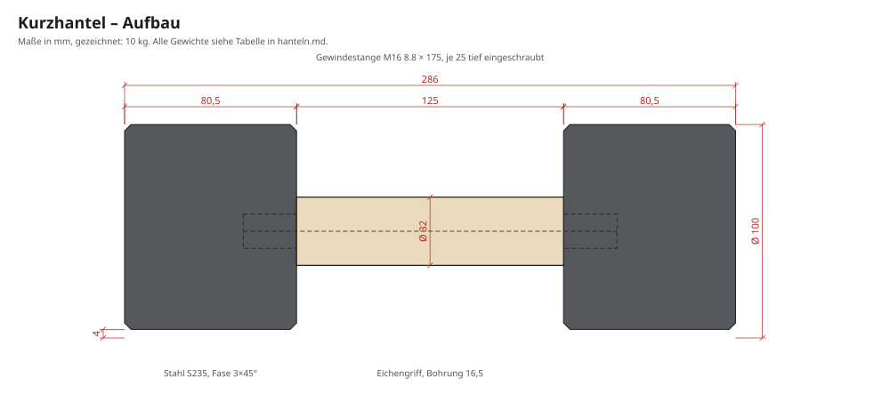

# Hanteln

> Automatisch erzeugt aus `params.toml` mit `python3 tools/build.py`. Nicht von Hand ändern.

Fünf Paar Kurzhanteln, passend zur Bank: schwarze Stahlköpfe, Griff aus Eiche. Die Maße sind so gewählt, dass jedes Paar genau in sein Fach passt (Belegung siehe [berechnung.md](berechnung.md)).

## Aufbau

- **Köpfe:** Rundstahl S235, gedreht. Fase 3 × 45° an allen Kanten, zentrisches Sackloch M16 × 25 mm, 4 mm tiefe Abflachung. Mit ihr rollt die Hantel nicht weg und liegt stabil im Fach.
- **Kern:** Gewindestange M16, Festigkeitsklasse 8.8. Sie hält beide Köpfe, die Eichenhülse wird dazwischen geklemmt.
- **Griff:** Eiche gedreht, Ø 32 mm, Bohrung 16,5 mm, Länge 125 mm. Optional mit feinen Längsrillen wie die Lamellen der Bank, das gibt Grip.
- **Oberfläche:** Köpfe brüniert und gewachst (Patina gewollt) oder matt schwarz pulverbeschichtet. Griff geölt.
- **Gewicht Griff + Kern:** 249 g, der Rest steckt in den Köpfen.

## Maße

| Hantel | Kopf Ø | Kopflänge | Hantel gesamt | Kopf je Stück | Gewindestange | Rohteil je Kopf (gesägt) | g je mm Kopflänge |
|---:|---:|---:|---:|---:|---:|---:|---:|
| 2,5 kg | 70 mm | 38,6 mm | 202 mm | 1,13 kg | M16 × 175 | Ø 73 × 44 mm | 30 g |
| 3,5 kg | 70 mm | 55,6 mm | 236 mm | 1,63 kg | M16 × 175 | Ø 73 × 61 mm | 30 g |
| 5,0 kg | 80 mm | 61,8 mm | 249 mm | 2,38 kg | M16 × 175 | Ø 83 × 67 mm | 39 g |
| 7,5 kg | 90 mm | 74,2 mm | 273 mm | 3,63 kg | M16 × 175 | Ø 93 × 79 mm | 49 g |
| 10,0 kg | 100 mm | 80,5 mm | 286 mm | 4,88 kg | M16 × 175 | Ø 103 × 86 mm | 61 g |

Je Gewicht wird ein Paar gebaut, also 10 Köpfe. Breite der Abflachung: Ø 70: 32 mm, Ø 80: 35 mm, Ø 90: 37 mm, Ø 100: 39 mm.

## Fertigung

1. **Rohteile:** Rundstahl S235 beim Stahlhandel auf Länge sägen lassen. Je Kopf Ø + 3 mm und Länge + 5 mm.
2. **Drehen** (Dreherei oder eigene Drehbank): Außen-Ø, Planflächen und Fasen. Zentrisch bohren (Ø 14) und Gewinde M16 × 25 schneiden.
3. **Abflachung** 4 mm tief fräsen.
4. **Auf Gewicht bringen:** Die Köpfe sind 2 mm länger gedreht. Hantel probehalber montieren, wiegen und an der Außenseite abplanen, bis das Gewicht stimmt (siehe Spalte g je mm). Toleranz ±1 %.
5. **Oberfläche:** brünieren und wachsen, oder pulverbeschichten (Gewinde abdecken).
6. **Griff:** Eiche drehen, eventuell Rillen fräsen, ölen.
7. **Montage:** Gewindestange mit hochfester Schraubensicherung (z. B. Loctite 270) in den ersten Kopf drehen. Griff aufschieben, zweiten Kopf mit Sicherung aufdrehen, bis der Griff fest geklemmt ist. 24 h aushärten lassen.

## Sicherheit

- Die Köpfe dürfen sich nie lösen. Deshalb hochfeste Sicherung und eine Gewindestange der Klasse 8.8, keine Baumarkt-Gewindestange 4.6.
- Den festen Sitz anfangs vor jedem Training prüfen, später monatlich.
- Nicht fallen lassen: Stahl auf Parkett hinterlässt Dellen, und der Holzgriff kann reißen.

## Kosten (Schätzung)

| Posten | Kosten |
|---|---:|
| Rundstahl, ca. 32 kg à 4 €/kg | ca. 129 € |
| Dreherei: 10 Köpfe drehen, bohren, Gewinde, Abflachung | 250–450 € |
| Brünieren oder Pulverbeschichten | 50–100 € |
| Gewindestange M16 8.8, Eiche, Schraubensicherung, Öl | 30–50 € |
| **Gesamt** | **ca. 459–729 €** |

Mit eigener Drehbank fallen die Dreherei-Kosten weg.
