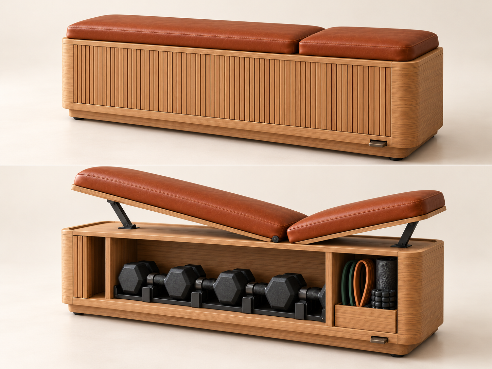

# Konzept: Bank am Bettende, die zur Flach- und Schrägbank wird

## Die Idee

Ein hochwertiges Möbelstück aus massiver Eiche und Cognac-Leder für das Ende eines 180-cm-Betts.
Im Alltag ist es eine Sitzbank. Zum Training nimmt man die selbstgebauten Hanteln heraus, rollt die Bank vom Bett weg und nutzt sie flach oder als Schrägbank:
die Rückenlehne von 25° bis 85°, den Sitz zusätzlich um 10° oder 20° geneigt.

## Bildentwurf und Umsetzung

| Bildentwurf | Umsetzung im Modell | |
|---|---|---|
| Gerundete senkrechte Korpusecken | Ecken R 70 aus massiven Eichen-Eckstollen, Faser senkrecht | ✓ |
| Lamellenfront, die links in eine Tasche läuft | Rolltür aus 65 gerundeten Eichenlamellen auf Leinen. Offen läuft sie in die Tasche links und hinter den Fächern entlang | ✓ |
| Polster in einer Holzwanne mit sichtbarer Eichenkante | 20 mm hoher Rand, Polsterplatte mit Eichenkante, Leder darüber | ✓ |
| Lange Lehne links, kurzer Sitz rechts, beide neigbar | Lehne 893 mm (25°–85°), Sitz 400 mm (0°, 10°, 20°) | ✓ |
| Schwarze Stahlstützen | Sitz: Klappbügel am Ende wie im Bild. Lehne: Klappstütze **unter der Lehnenmitte**, weil eine Stütze am Ende 85° nicht erreicht und sich nicht flach wegklappen lässt | angepasst |
| Hanteln auf schwarzer Ablage | schwarze Ablage unter jedem Kopf | ✓ |
| 4 Sechskanthanteln in einer Reihe | 5 Paar runde Hanteln (deine Wahl) auf 2 Ebenen. In eine Reihe passen sie nicht | angepasst |
| Ein großes Mittelfach | Zwei Hantelfächer. Ein durchgehendes Fach wäre für Deckel und Fachboden zu weit gespannt | angepasst |
| Zubehörfach rechts | Fach rechts mit Fachboden für Bänder und Manschetten | ✓ |
| Eichensockel mit schwarzen Füßen | Sockelzarge zurückgesetzt, Ecken gerundet, 4 schwarze Füße | ✓ |
| Bronze-Element vorn rechts | Fußhebel für die verdeckten Absenkrollen | ✓ |

| Möbel | Training |
|---|---|
|  |  |

## Macht das Sinn? Ja.

| | Bank am Bettende | Trainingsbank | Technogym Bench | **Dieser Entwurf** |
|---|---|---|---|---|
| Höhe | 42–48 cm, unter der Matratzenoberkante | 42–45 cm (Wettkampfnorm IPF) | 45,5 cm | **45 cm** |
| Länge | Bettbreite minus 20–40 cm | 110–125 cm | 112,9 cm | **140 cm** |
| Polsterbreite | 35–45 cm | 26–32 cm | 37,6 cm | **35,8 cm** |
| Sitz / Lehne | – | ca. 30–40 / 75–95 cm | – | **40 / 89,3 cm** |

- **Ein Kasten ist steifer als ein Gestell.** Mantel, Deckel, Boden, drei Trennwände und die verleimte Rückwand bilden eine geschlossene Box ([berechnung.md](berechnung.md)).
- **Die Bank kippt praktisch nicht.** Die Füße stehen fast unter der Polsterkante.
- **Das Gewicht hilft.** Leer wiegt die Bank etwa 65 kg, mit Hanteln etwa 129 kg. Sie wandert beim Training nicht.
- **Der Stauraum löst das eigentliche Problem.** Im Schlafzimmer liegen keine Hanteln herum.

## Am Bettende

| Thema | Lösung |
|---|---|
| Länge | 140 cm bei einem 180-cm-Bett, also je Seite 20 cm Luft |
| Höhe | 45 cm, unter der üblichen Matratzenoberkante (50–65 cm) |
| Ausrichtung | Rolltür zum Raum, Rückseite zum Bett. Die Rückwand ist furniert, weil man sie vom Bett aus sieht |
| Zum Training abrücken | Bronze-Fußhebel treten: Vier verdeckte Rollen fahren aus, und die Bank rollt ca. 60 cm vom Bett weg. Hebel hochziehen, dann steht sie wieder fest. Den Platz braucht man, weil die Ellbogen beim Drücken unter Polsterhöhe gehen und auf der Schrägbank ein Fuß neben der Bank steht |
| Boden | Die Rollen sind für Parkett und Fliesen gedacht |

## Leder: die hochwertigste Wahl, aber die richtige Sorte

Echtes Leder ist das hochwertigste Polstermaterial. Bei einer Trainingsbank kommt es aber auf die Sorte an, weil Schweiß Salz und Säure enthält:

| Lederart | Optik | Für diese Bank |
|---|---|---|
| Anilinleder | am natürlichsten, offenporig | ✗ Schweiß und Wasser hinterlassen Flecken |
| Nubuk, Velours | samtig | ✗ saugt Schweiß auf |
| **Semianilin** | natürlich, leicht pigmentiert | ✓ guter Kompromiss |
| **Pigmentiertes Vollnarbenleder** | gleichmäßige Farbe, matt | ✓ am robustesten, abwischbar, farbstabil |

**Empfehlung:** vollnarbiges Rindleder in Cognac, pigmentiert oder Semianilin mit Schutzfinish, 1,2–1,5 mm, mit Kedernaht. Nach dem Training feucht abwischen, zweimal im Jahr pflegen.

## Mechanik

| Lehne | Sitz | Wofür |
|---|---|---|
| 0° | 0° | Sitzbank, Kurzhantel-Bankdrücken, Rudern, Hip Thrust |
| 25° / 35° | 10° | Schrägbankdrücken (obere Brust), Fliegende schräg |
| 45° | 10° / 20° | steiles Schrägbankdrücken, Incline Curls |
| 60° / 75° | 20° | Schulterdrücken mit Schräge |
| 85° | 20° | Schulterdrücken sitzend, Curls mit Rückenlehne |

**Drehachsen:** Lehne und Sitz drehen um je eine Achse an ihrer inneren Kante, 25 mm unter der Polsteroberfläche.
Weil die Achsen fast auf Sitzhöhe liegen, bleibt die Fuge zwischen den Polstern in jeder Stellung klein.
Beide Achsen sitzen in einer gemeinsamen schmalen Stahlplatte vorn und hinten im Spalt zwischen Polster und Rand.

**Rückenlehne:** Unter der Lehne hängt eine U-förmige Klappstütze aus Flachstahl. Ihr Querstab rastet in zwei schwarzen Eichenleisten in der Wanne.
Bei flacher Lehne liegt die Stütze zusammengeklappt in der Wanne, der Querstab in einer tieferen Parkrast.
Zum Verstellen die Lehne am linken Ende anheben, den Querstab in die gewünschte Rast setzen und die Lehne ablegen.

**Sitz:** Unter dem Sitzende liegen zwei ineinander geschachtelte Klappbügel, einer für 10° und einer für 20°.
Zum Neigen den Sitz anheben, den passenden Bügel hochklappen und den Sitz darauf ablegen. Flach liegen beide Bügel in der Wanne.

**Belastung:** Gerechnet sind 120 kg Nutzer mit Stoßfaktor 1,5, in zwei Lastfällen: Gewicht senkrecht nach unten und kräftiges Zurücklehnen senkrecht gegen die Lehne.
Die Lehnenstütze trägt bis 1,8 kN und hält ein Vielfaches davon aus, bevor sie knickt (Sicherheit ≈ 10). Die Sitzbügel tragen gut 0,8 kN.
Bei steiler Lehne zieht die Achse nach oben, deshalb sind die Gelenkplatten auf eine Stahl-Gegenplatte unter dem Deckel geschraubt.

## Was das Design hochwertig macht

| Detail | Umsetzung |
|---|---|
| **Weiche Form** | Ecken R 70 aus massiven Eckstollen. Die Maserung läuft senkrecht um die Rundung |
| **Lamellen-Rolltür** | Gerundete Eichenlamellen auf Leinen, ohne Griffe und Beschläge. Sie verschwindet ganz im Korpus |
| **Polsterwanne** | Die Polster liegen in einem 20 mm hohen Eichenrand, darunter eine sichtbare Eichenkante (wie im Bildentwurf) |
| **Leder** | Cognac, vollnarbig, mit Kedernaht |
| **Schwebender Sockel** | Eichenzarge zurückgesetzt, schwarze Füße, Rollen unsichtbar |
| **Bronze-Akzent** | Fußhebel vorn rechts |
| **Passende Hanteln** | Schwarze Stahlköpfe und Eichengriffe auf schwarzer Ablage ([hanteln.md](hanteln.md)) |

Eine dunkle Alternative (Nussbaum, schwarzes Leder, Messing) ist im Modell mit `farbschema = "nussbaum"` umschaltbar.

## Aufbau

| Bauteil | Funktion |
|---|---|
| **Mantel** | Stirnseiten und Eckstollen aus Eiche massiv, furnierte Rückwand, Frontleisten oben (mit Rand) und unten |
| **Deckel, Boden** | Eiche massiv 24 mm, Ecken gerundet, Laufnuten für die Rolltür |
| **Rolltür** | 65 Lamellen, läuft vorn, in der Tasche links und hinter den Fächern in Nuten |
| **Trennwände, Fachböden** | Tasche + 3 Fächer (440 / 440 / 308 mm), je 2 Ebenen. Die Trennwände enden vor der hinteren Rolltürbahn |
| **Rastleisten / Auflageleisten** | schwarz gebeizte Eiche in der Wanne, tragen die Polster und versteifen den Deckel |
| **Lehne** | Polsterplatte mit 2 Eichenrippen, Klappstütze, Gelenkplatten |
| **Sitz** | Polsterplatte, 2 Klappbügel, Gelenkplatten |
| **Sockel** | Eichenzarge, 4 Füße, 4 Absenkrollen auf einer Exzenterwelle, Bronze-Fußhebel |

Stauraum (Rolltür offen):

## Fertigung und Kosten

- **Schreiner:** Korpus, Rolltür, Leisten, Polsterplatten, Endmontage. Die Unterlagen stehen in [schreiner.md](schreiner.md), druckfertig als [schreiner-mappe.pdf](schreiner-mappe.pdf).
- **Metallbau:** Gelenkplatten, Klappstütze, Sitzbügel, Absenkrollen-Mechanik.
- **Polsterei:** Leder mit Kedernaht.
- **Hanteln:** selbst bzw. Dreherei ([hanteln.md](hanteln.md)).

Kosten mit Schreiner grob **5.700–9.700 €**, dazu die Hanteln für ca. 450–750 € (Aufschlüsselung in der [Stückliste](stueckliste.md)).
Gegenüber dem vorigen Entwurf machen die Rundungen, die Rolltür, der neigbare Sitz und die Absenkrollen die Bank deutlich aufwendiger.
Das Angebot des Schreiners wird die Zahl genauer zeigen.

## Referenz: Technogym Bench

Laut Händlerangaben: 1129 × 376 × 455 mm, leer 35,2 kg, max. Nutzergewicht 120 kg, 5 Paar Kurzhanteln 2,5–10 kg, Bänder, Knuckles, Matte, nur Flachbank.
Quellen: [Winnings](https://www.winnings.com.au/p/technogym-multifunctional-bench-dgy100),
[Northern Fitness](https://www.northernfitness.ca/products/technogym-bench),
[ArchiPro](https://archipro.com.au/product/technogym-bench-workout-bench-technogym)
