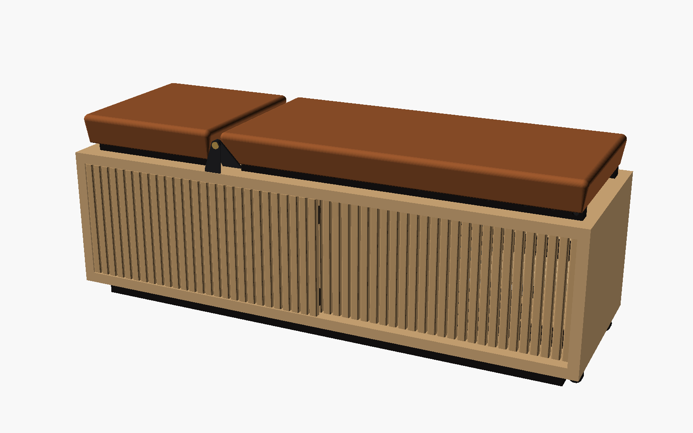
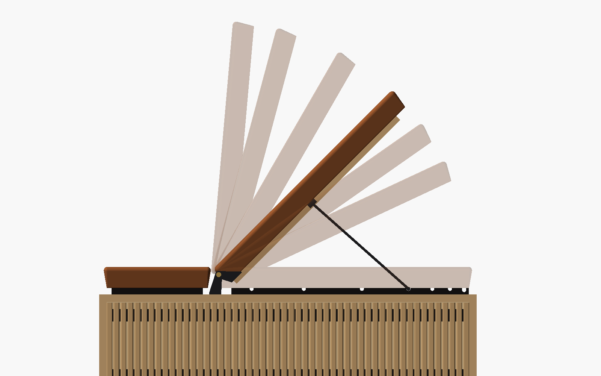
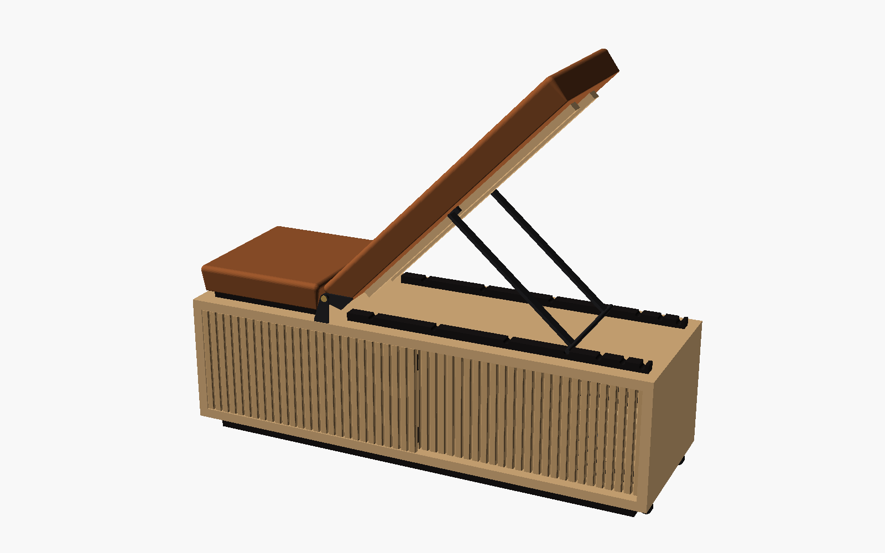
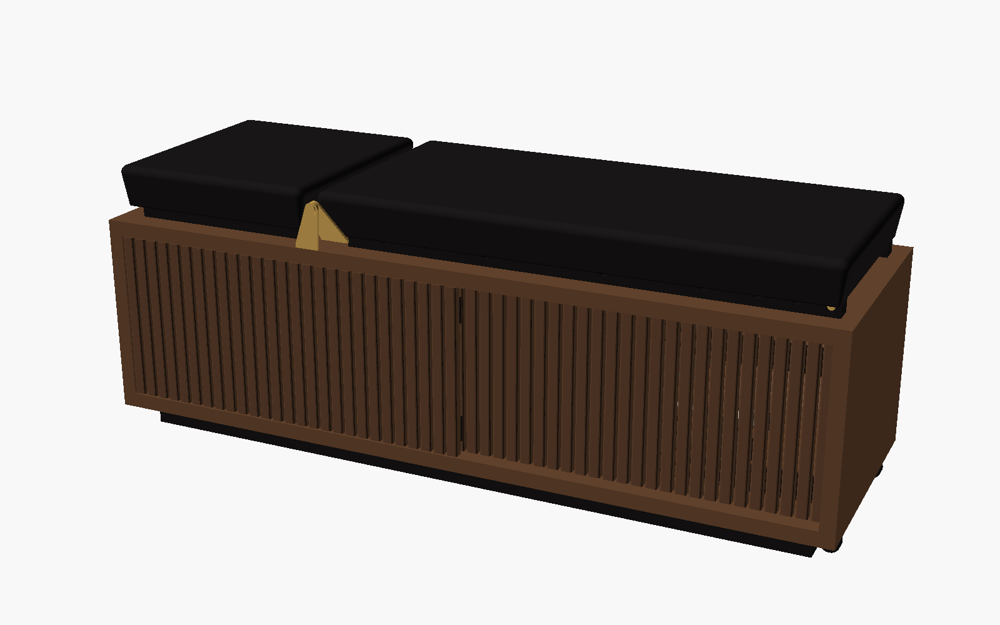
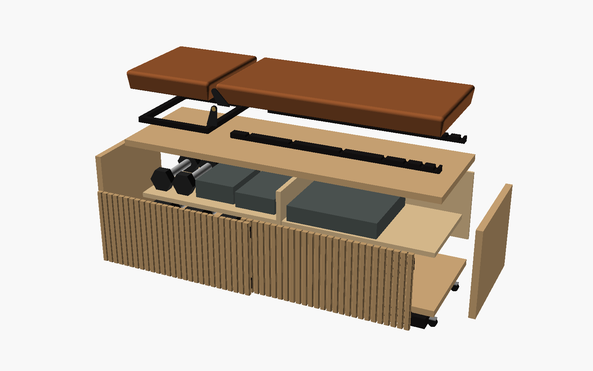
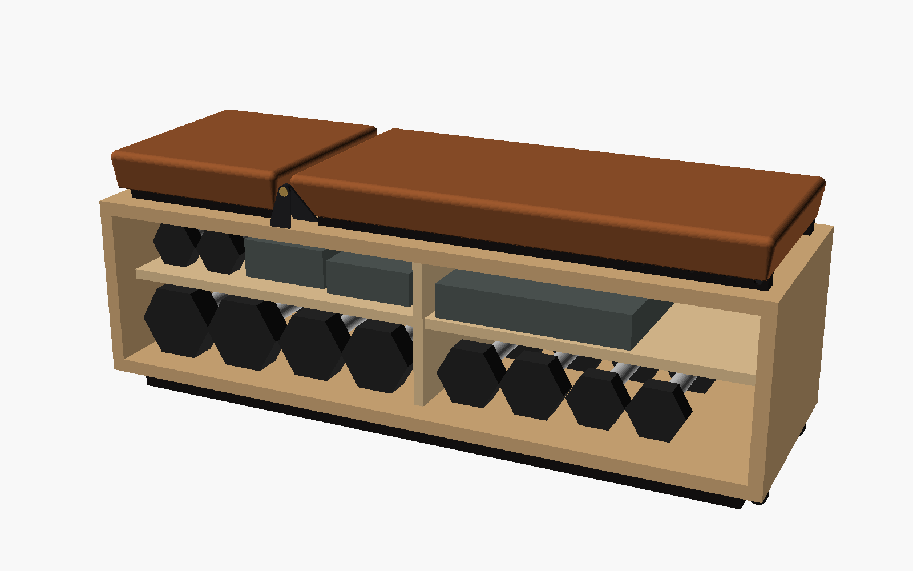

# Konzept: Sitzbank, die zur Flach- und Schrägbank wird

## Die Idee

Ein hochwertiges Möbelstück, das im Alltag als gepolsterte Sitzbank im Flur, am Bettende oder im Wohnzimmer steht.
Zum Training nimmt man die Hanteln aus dem Stauraum und nutzt die Bank flach. Oder man stellt die Rückenlehne in einer von sechs Stellungen zwischen 25° und 85° auf und nutzt sie als Schrägbank.
Vorbild ist die [Technogym Bench](https://www.technogym.com/en-US/product/technogym-bench_DGY100.html), die allerdings nur flach ist.

## Macht das Sinn? Ja.

**Die Maße einer Sitzbank und einer Trainingsbank sind fast gleich.**

| | Sitzbank (Möbel) | Trainingsbank | Technogym Bench | **Dieser Entwurf** |
|---|---|---|---|---|
| Höhe | 43–47 cm | 42–45 cm (Wettkampfnorm IPF) | 45,5 cm | **45 cm** |
| Länge | 100–140 cm | 110–125 cm | 112,9 cm | **120 cm** |
| Polsterbreite | 35–45 cm | 26–32 cm | 37,6 cm | **37 cm** |
| Sitz / Lehne | – | ca. 30–35 / 75–85 cm | – | **34 / 80,5 cm** |

- **Ein Kasten ist steifer als ein Gestell.** Deckel, Boden, Wangen und die verleimte Rückwand bilden eine geschlossene Box ([berechnung.md](berechnung.md)).
- **Die Bank kann im Training nicht kippen.** Sie kippt erst, wenn rund 300 kg auf der Längskante stehen, mit Hanteln im Stauraum rund 700 kg.
- **Das Gewicht hilft.** Leer wiegt die Bank etwa 46 kg, mit Hanteln etwa 110 kg. Beim Hip Thrust oder beim Rudern wandert sie nicht.
- **Der Stauraum löst das eigentliche Problem.** Die Hanteln liegen sonst sichtbar herum, hier hinter einer Lamellenfront.

## Schrägbank-Mechanik

| Stellung | Wofür |
|---|---|
| 0° flach | Sitzbank, Kurzhantel-Bankdrücken, Rudern, Hip Thrust, Step-ups |
| 25° / 35° | Schrägbankdrücken (obere Brust), Fliegende schräg |
| 45° | Schrägbankdrücken steil, Incline Curls, brustgestütztes Rudern |
| 60° / 75° | Schulterdrücken mit Schräge, Seitheben sitzend |
| 85° | Schulterdrücken sitzend, Bizeps-Curls mit Rückenlehne |

**So funktioniert sie:**

1. **Drehachse:** Die Rückenlehne dreht sich um eine Achse an ihrer Vorderkante, 25 mm unter der Polsteroberfläche.
   Weil die Achse fast auf Sitzhöhe liegt, bleibt die Fuge zwischen Sitz und Lehne in jeder Stellung klein (25 mm), und die Lehne beginnt direkt am Sitz.
   Getragen wird die Achse von zwei schmalen Stahlplatten an der Vorder- und Rückseite, in der 15 mm breiten Fuge zwischen Polster und Korpuskante.
   Sie sind das einzige sichtbare Metall, in Schwarz oder Messing.
2. **Klappstütze:** Unter der Lehne hängt eine U-förmige Stütze aus Flachstahl mit einem Querstab.
   Ihr Querstab rastet in **zwei schwarzen Eichenleisten** auf dem Deckel ein. Die Leisten liegen in der Schattenfuge unter dem Polster und sind bei flacher Lehne unsichtbar.
3. **Parkstellung:** Bei flacher Lehne liegt die Stütze zusammengeklappt in der Schattenfuge, der Querstab versenkt in einer tieferen Parkrast.
   Die Lehne liegt dann vollflächig auf den Leisten auf und ist eine normale Flachbank.

**Bedienung:** Lehne am Ende anheben, bis die Stütze frei nach unten pendelt. Querstab in die gewünschte Rast setzen und die Lehne ablegen.
Zurück: Lehne kurz anheben, Stütze an die Lehne klappen, Querstab in die Parkrast legen und die Lehne ablegen.

**Belastung:** Gerechnet sind 70 % von 120 kg mit Stoßfaktor 1,5. Dabei gibt es zwei Lastfälle: das Gewicht senkrecht nach unten und kräftiges Zurücklehnen senkrecht gegen die Lehne.
Die Stütze trägt bis 4,2 kN bei etwa sechsfacher Sicherheit gegen Knicken. Bei steiler Lehne zieht die Achse nach oben, deshalb sind die Gelenkplatten durch den Deckel auf eine Stahl-Gegenplatte geschraubt.
Die Lehnenplatte ist mit zwei Eichenrippen versteift und biegt sich im ungünstigsten Fall um etwa 1,3 mm durch.

**Grenzen:**

- Flacher als 25° geht mit einer einzigen Klappstütze nicht, weil die Rast dann mit der Parkrast zusammenfiele. Eine 15°-Stellung bräuchte eine zweite, kurze Stütze (Option für später).
- Der Sitz ist fest. Ein abnehmbarer Sitzkeil (ca. 10°) gegen Herunterrutschen bei steiler Lehne ist als Option vorgesehen.
- Keine Negativ-Schräge und keine Langhantel-Ablage.

## Was das Design hochwertig macht

| Detail | Umsetzung |
|---|---|
| **Massivholz statt Platte** | Korpus aus 24 mm Eiche massiv. Deckel, Wangen und Boden sind auf Gehrung aus einem Brett geschnitten, sodass die Maserung ohne Unterbrechung um den Korpus läuft. Nirgends sind Hirnholz oder Plattenkanten zu sehen |
| **Schwebender Korpus** | Der Sockel ist schwarz und 40 mm zurückgesetzt. Der Korpus scheint über dem Boden zu schweben |
| **Lamellenfront** | Massive Eichenlamellen mit gerundeten Kanten auf verdeckten Traversen. Die 4-mm-Fugen lüften den Stauraum. Die Türen laufen in Nuten im Deckel und im Boden, ohne sichtbare Beschläge und ohne Griffe (man greift in die Fuge) |
| **Polster mit Schattenfuge** | Die Lederpolster sind rundum 15 mm eingerückt und liegen auf einer 20 mm hohen schwarzen Schattenfuge. Rastleisten und Stütze verschwinden darin |
| **Leder** | Vollnarbiges Rindleder (Cognac oder Schwarz) mit Kedernaht. Es ist abwischbar und schweißfest und gewinnt mit den Jahren an Patina. Alternative: hochwertiges Kunstleder |
| **Reduziertes Metall** | Sichtbar sind nur die zwei Gelenkplatten mit Messingkappe. Rollen, Schrauben und Gegenplatten liegen verdeckt |
| **Verdeckter Transport** | Die Rollen sitzen unter dem Korpusüberstand. Zum Verschieben das linke Ende ca. 17 cm anheben |
| **Oberfläche** | Hartwachsöl. Man kann es ausbessern, es fühlt sich warm an, und es verträgt Schweiß und Wischen |

### Farbvarianten

| Eiche natur + Cognac-Leder + Schwarzstahl | Nussbaum + schwarzes Leder + Messing |
|---|---|
|  |  |

Weitere sinnvolle Kombinationen: Räuchereiche + Cognac, Eiche weiß geölt + Sand/Greige-Leder.
Im Modell umschaltbar mit `farbschema` in [cad/bank.scad](../cad/bank.scad).

## Zielkonflikte und wie der Entwurf sie löst

| Thema | Möbel will … | Training will … | Lösung |
|---|---|---|---|
| Polsterbreite | breit, bequem | 26–32 cm, Schulterblätter frei | 37 cm (wie Technogym), Korpus trotzdem 40 cm |
| Polsterhärte | weich | fest, stabile Kante | 30 mm hart (RG 50+) + 20 mm mittel (RG 35–40), Watte für weiche Kanten |
| Lehne | durchgehende Sitzfläche | verstellbar | Fuge nur 25 mm. Die Lehne liegt flach bündig mit dem Sitz, die Mechanik ist unsichtbar |
| Bezug | Stoff, Wolle | abwischbar, schweißfest | Leder. **Kein Bouclé** |
| Stauraum | geschlossene Front | schneller Zugriff | 2 Schiebetüren, 2 Fächer. Eine Tür zur Seite, und ein ganzes Fach ist frei |
| Feuchtigkeit | – | verschwitztes Zubehör | Lamellenfugen lüften, Hartwachsöl, Leim D3 |
| Verschieben | soll beweglich sein | darf nicht rutschen | Gummipads unter dem Sockel. Rollen verdeckt, sie greifen nur beim Ankippen |

## Aufbau

| Bauteil | Funktion |
|---|---|
| **Sitz** | 340 mm, fest. Mit 4 Schrauben von unten durch Deckel und Distanzrahmen in Einschlagmuttern der Sitzplatte |
| **Rückenlehne** | 805 mm. 18 mm Polsterplatte mit 2 verleimten Eichenrippen, Unterseite furniert |
| **Gelenkplatten** | Je 2 außen (Korpus) und innen (Lehne), Bolzen M10 mit Gleitlagerbuchse |
| **Klappstütze** | 2 Beine Flachstahl 25 × 8 mm, Querstab Ø 12 mm, Lagerböcke an den Rippen |
| **Rastleisten** | 2 × Eiche schwarz, auf den Deckel geleimt. 6 Arbeitsrasten (8 mm tief) + Parkrast (12 mm). Sie versteifen zugleich die Vorderkante |
| **Deckel, Boden, Wangen** | Eiche massiv 24 mm, Gehrung mit Domino. Laufnuten für die Türen in Deckel und Boden |
| **Rückwand** | Multiplex eichefurniert, in Nut verleimt. Steift den Kasten aus |
| **Mittelwand, Fachböden** | 2 Fächer mit je 2 Ebenen. Unten 140 mm für die schweren Hanteln. Ablagen mit Filz oder Leder belegt |
| **Schiebetüren** | Je 27 Eichenlamellen auf 2 verdeckten Traversen |
| **Sockel** | Schwarz gebeizter Rahmen, 40 mm zurückgesetzt, mit Antirutschpads |
| **Rollen** | 2 × Ø 30 mm, verdeckt unter dem rechten Überstand |

Stauraum mit dem Technogym-Inventar (Hantelmaße geschätzt, siehe [berechnung.md](berechnung.md)):

## Material

| Option | Optik | Vorteile | Nachteile |
|---|---|---|---|
| **Eiche massiv 24 mm** (Standard) | warm, lebendige Maserung | wertig, ausbesserbar, Gehrung mit umlaufender Maserung möglich | arbeitet quer zur Faser (bei 40 cm Tiefe ca. 2–3 mm). Alle Teile sind so ausgerichtet, dass sie in dieselbe Richtung arbeiten |
| Nussbaum massiv | dunkel, edel | sehr hochwertig, schöne Maserung | teurer (ca. 1,5–2 × Eiche) |
| Räuchereiche | dunkelbraun, gleichmäßig | modern, passt zu Cognac-Leder | teurer, Farbe von Brett zu Brett leicht verschieden |
| Eichefurnier auf Multiplex + Massivkanten | wie Massivholz | formstabil, günstiger | Kanten müssen angeleimt werden, Gehrung mit umlaufender Maserung nur mit Furnierbild |

## Fertigung

Bei diesem Anspruch würde ich die Arbeit aufteilen:

- **Korpus und Türen:** Schreinerei oder gut ausgestattete eigene Werkstatt. Saubere Gehrungen über 40 cm brauchen eine Formatkreissäge oder eine präzise Tauchsäge mit Schiene und Domino.
- **Polster:** Polsterei. Leder mit Kedernaht sieht nur mit Erfahrung wirklich gut aus.
- **Stahlteile:** Laserzuschnitt-Dienst plus Pulverbeschichtung, oder Messing beim Metallbauer. Die Zeichnungen dafür entstehen in Phase 2.
- **Rastleisten, Rippen, Sockel:** einfach und gut selbst machbar.

## Referenz: Technogym Bench

Daten laut Händlerangaben (die Technogym-Seite war beim Abruf nicht erreichbar):

- 1129 × 376 × 455 mm, leer 35,2 kg, mit Zubehör 98,8 kg, max. Nutzergewicht 120 kg
- Zubehör: 5 Paar Kurzhanteln (2,5 / 3,5 / 5 / 7,5 / 10 kg), 3 Widerstandsbänder, 3 Paar Knuckles (0,45 / 0,8 / 1,2 kg), Trainingsmatte
- nur Flachbank, Halterungen mit Abstandshaltern gegen eingeklemmte Finger, Rollen an einer Stirnseite

Quellen: [Winnings](https://www.winnings.com.au/p/technogym-multifunctional-bench-dgy100),
[Northern Fitness](https://www.northernfitness.ca/products/technogym-bench),
[ArchiPro](https://archipro.com.au/product/technogym-bench-workout-bench-technogym)
