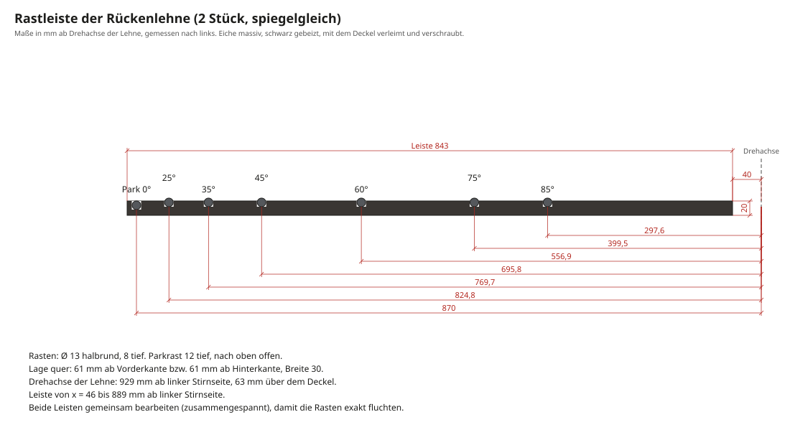

# Unterlagen für den Schreiner

Sitzbank für das Bettende, die zugleich eine verstellbare Trainingsbank ist (flach bis 85°). Darin ist Stauraum für Kurzhanteln.
Diese Unterlagen sind ein **Entwurf mit Hauptmaßen**. Verbindungen, Beschläge und Fertigungsdetails legt der Schreiner fest, Fragen dazu stehen am Ende.

**Maßgeblich sind die Zeichnungen und die [Stückliste](stueckliste.md).** Beide werden aus einer zentralen Parameterdatei erzeugt und sind untereinander stimmig.

## Das Wichtigste in Kürze

| Thema | Festlegung |
|---|---|
| Aufstellort | Bettende eines 180-cm-Betts. Vorderseite mit Türen zum Raum, Rückseite zum Bett (ist sichtbar) |
| Außenmaße | 1400 × 400 × 450 mm (L × T × H), Polsteroberkante = Sitz- und Trainingshöhe 450 mm |
| Korpus | Eiche massiv 24 mm, Ecken auf Gehrung mit umlaufender Maserung, Hartwachsöl |
| Front | 3 Schiebetüren aus Eichenlamellen auf 2 Spuren, ohne sichtbare Beschläge und Griffe |
| Innen | 2 Mittelwände, 3 Fächer mit je einem Fachboden. Untere Ebene 140 mm licht (Hanteln) |
| Sockel | schwarz, 40 mm rundum zurückgesetzt („schwebender“ Korpus) |
| Polster | Sitz 400 mm fest, Rückenlehne 945 mm klappbar. Cognac-Leder, rundum 15 mm eingerückt, 20 mm Schattenfuge |
| Mechanik | Lehne dreht um eine Achse 25 mm unter der Polsteroberfläche. Eine Klappstütze aus Stahl rastet in zwei schwarzen Eichenleisten auf dem Deckel. Stellungen 0°, 20°, 30°, 45°, 60°, 75°, 85° |
| Belastung | Nutzer bis 120 kg, gerechnet mit Stoßfaktor 1,5 (siehe [Berechnung](berechnung.md)) |
| Gewicht | ca. 54 kg leer, ca. 118 kg mit Hanteln |

## Wer macht was

| Gewerk | Umfang |
|---|---|
| **Schreiner** | Korpus, Mittelwände, Fachböden, Rückwand, Lamellentüren, Sockel, Rastleisten, Sitz-Distanzrahmen, Polsterplatten mit Eichenrippen, Oberfläche, Endmontage einschließlich Metallteile und Rollen |
| **Metallbau** | Gelenkplatten (4), Gegenplatten (2), Klappstütze geschweißt, Lagerböcke, Bolzen, pulverbeschichtet schwarz. Nach Aufmaß am fertigen Korpus |
| **Polsterei** | Schaum, Watte, Leder mit Kedernaht auf die vom Schreiner gelieferten Polsterplatten |
| **Bauherr** | Hanteln (eigene Fertigung, [hanteln.md](hanteln.md)), Filz- oder Ledereinlagen in den Fächern |

Ideal wäre es, wenn der Schreiner Metallbau und Polsterei koordiniert. Die Mechanik muss am Korpus zusammenpassen.

## Kritische Maße

| Maß | Wert | Warum |
|---|---|---|
| Polsteroberkante | 450 mm | Sitzhöhe und Hantelbank-Norm |
| Drehachse | 440 mm ab links, 63 mm über Deckel | Die Mechanik ist darauf berechnet |
| Rasten | nach Zeichnung, ±0,5 mm | Sonst stimmen die Winkel nicht, oder die Stütze klemmt |
| Schattenfuge | 20 mm | Darin liegen die Stütze (8 mm Flachstahl) und die Rippen (18 mm) |
| Lichte Höhe untere Ebene | ≥ 140 mm | Die größte Hantel liegt 96 mm hoch und braucht Platz zum Greifen |
| Fachtiefe | 332 mm | Die längste Hantel ist 286 mm lang |
| Fachbreite | ca. 438 mm | Zwei Hantelpaare nebeneinander |

## Zeichnungen

### Übersicht

### Querschnitt

### Rastleisten: kritisches Maß

### Metallteile (Entwurf für den Metallbau)

### Verstellbereich und Explosionsansicht

## Konstruktionsvorgaben

1. **Gehrungskasten mit umlaufender Maserung.** Deckel, rechte Wange, Boden und linke Wange werden nacheinander aus einer Leimholzplatte geschnitten.
   Deckel und Boden haben die Faser in Längsrichtung, die Wangen senkrecht. So arbeiten alle vier Teile nur in der Tiefe (ca. 2–3 mm), und die Gehrungen bleiben geschlossen.
   Die Verbindung (Domino, Feder oder Lamello) wählt der Schreiner.
2. **Rückwand** Multiplex eichefurniert, 10 mm, in Nut ringsum und verleimt. Sie steift den Kasten aus.
   Weil die Rückseite zum Bett zeigt und sichtbar ist, gehört die gute Furnierseite nach außen.
3. **Mittelwände** tragen den Deckel mit, damit seine Spannweite nur rund 460 mm beträgt. Sie werden fest eingebaut (Domino oder Gratnut), nicht nur eingestellt.
4. **Schiebetüren:** Lamellen 14 mm mit gerundeten Vorderkanten und 4 mm Fuge, auf zwei verdeckte Traversen geleimt.
   Die obere Traverse hat eine Feder, die in einer 10 mm tiefen Nut im Deckel läuft. Unten laufen die Türen in 5 mm tiefen Nuten im Boden, mit Gleitband.
   Zum Einsetzen die Tür oben einschieben und unten absetzen. Die zwei äußeren Türen laufen vorn, die mittlere hinten, so ist jedes Fach einzeln ganz zu öffnen.
   Ein verdeckter Schiebetürbeschlag nach Wahl des Schreiners ist ebenso möglich.
5. **Rastleisten:** Eiche, schwarz gebeizt, mit dem Deckel **verleimt und verschraubt**. Sie versteifen die Vorderkante des Deckels.
   Die Rastpositionen sind **das kritische Maß** (±0,5 mm, siehe Zeichnung). Beide Leisten werden zusammengespannt bearbeitet, damit sie exakt fluchten.
6. **Sitz-Distanzrahmen** (schwarz) mit dem Deckel verleimt. Der Sitz wird von unten mit 4 × M6 durch Deckel und Rahmen in Einschlagmuttern der Sitzplatte verschraubt und bleibt so abnehmbar.
7. **Rückenlehne:** Polsterplatte Multiplex 18 mm mit zwei verleimten Eichenrippen 60 × 18 mm auf der Unterseite. Die Unterseite ist bei aufgestellter Lehne sichtbar, also furniert und geölt.
8. **Gelenk:** Drehachse 440 mm ab linker Stirnseite, 63 mm über dem Deckel. Die Gelenkplatten werden mit durchgehenden Schrauben auf je eine Stahl-Gegenplatte unter dem Deckel befestigt, weil bei steiler Lehne Zugkräfte auftreten.
   Lage der Bohrungen nach Abstimmung mit dem Metallbau.
9. **Sockel:** Rahmen schwarz, 40 mm rundum zurückgesetzt, mit Antirutschpads.
   Zwei gummierte Rollen Ø 30 mm sitzen verdeckt unter dem hinteren Überstand, je 150 mm von den Enden und 3 mm über dem Boden. Sie greifen nur, wenn man die Bank vorne anhebt, und dienen dazu, sie zum Training vom Bett wegzurollen.
10. **Fächer:** Fachböden auf Bodenträgern. Die Ablagen der Hantelfächer werden mit Filz oder Leder belegt, dazu kommen Abstandshalter aus Eiche zwischen den Hanteln.
11. **Oberfläche:** Hartwachsöl. Farbton vorher am Musterbrett abstimmen (natur oder „weiß“ gegen Nachdunkeln). Schwarze Teile beizen und ölen.

## Vorschlag für den Ablauf

1. Erstgespräch mit diesen Unterlagen, danach Angebot.
2. Musterbrett Eiche mit Öl, Lederprobe von der Polsterei.
3. Höhe 45 cm und Lehnenwinkel mit einem einfachen Probeaufbau testen.
4. Korpus, Türen und Rastleisten bauen.
5. Aufmaß für den Metallbau, Metallteile fertigen lassen.
6. Mechanik probeweise ohne Polster montieren und alle Rasten prüfen.
7. Polsterplatten zur Polsterei, danach Endmontage.
8. Abnahme:
    - Lehne in jeder Stellung mit ca. 100 kg belasten (Person lehnt sich kräftig an).
    - Türen laufen leicht.
    - Die Bank steht kippelfrei.

## Fragen an den Schreiner

- Welche Gehrungsverbindung (Domino, Feder, Lamello)?
- Türführung über Nut und Gleitband, oder ein verdeckter Beschlag?
- Bezugsquelle und Sortierung für das Eichen-Leimholz (durchgehende Lamelle)?
- Übernimmt die Schreinerei die Koordination mit Metallbau und Polsterei?
- Gibt es Vorschläge, die Mechanik zu vereinfachen oder in Holz statt Stahl auszuführen?

## Anfrage zum Kopieren

> Guten Tag,
>
> ich plane eine Sitzbank aus massiver Eiche für das Ende meines Betts. Sie ist gleichzeitig eine verstellbare Trainingsbank mit Stauraum für Hanteln.
> Außenmaße 1400 × 400 × 450 mm. Korpus aus Eiche massiv auf Gehrung, Schiebetüren aus Lamellen, Lederpolster (Polsterei) und eine klappbare Rückenlehne mit Stahlmechanik (Metallbau).
> Zeichnungen, Stückliste und eine Beschreibung der Konstruktion habe ich angehängt.
>
> Könnten Sie mir ein Angebot machen? Gern auch mit Ihren Vorschlägen zu Verbindungen, Türführung und Koordination von Metallbau und Polsterei.
>
> Vielen Dank und viele Grüße
