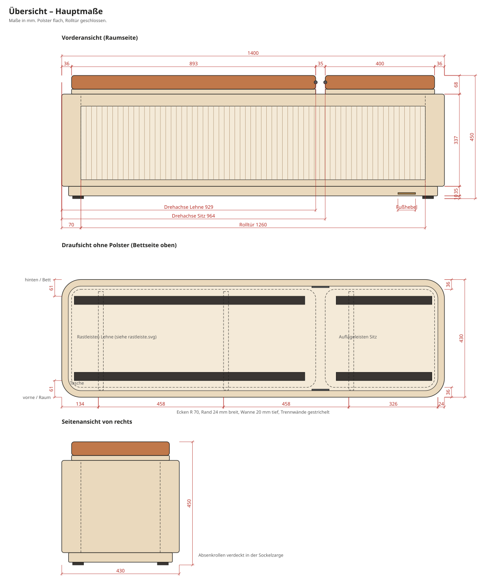
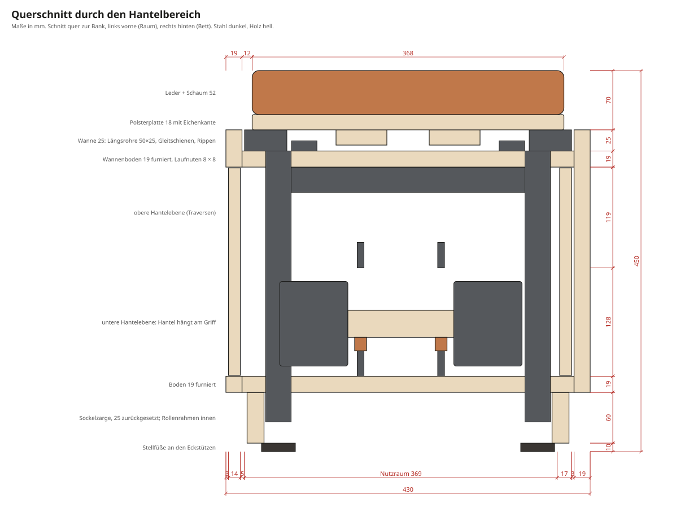
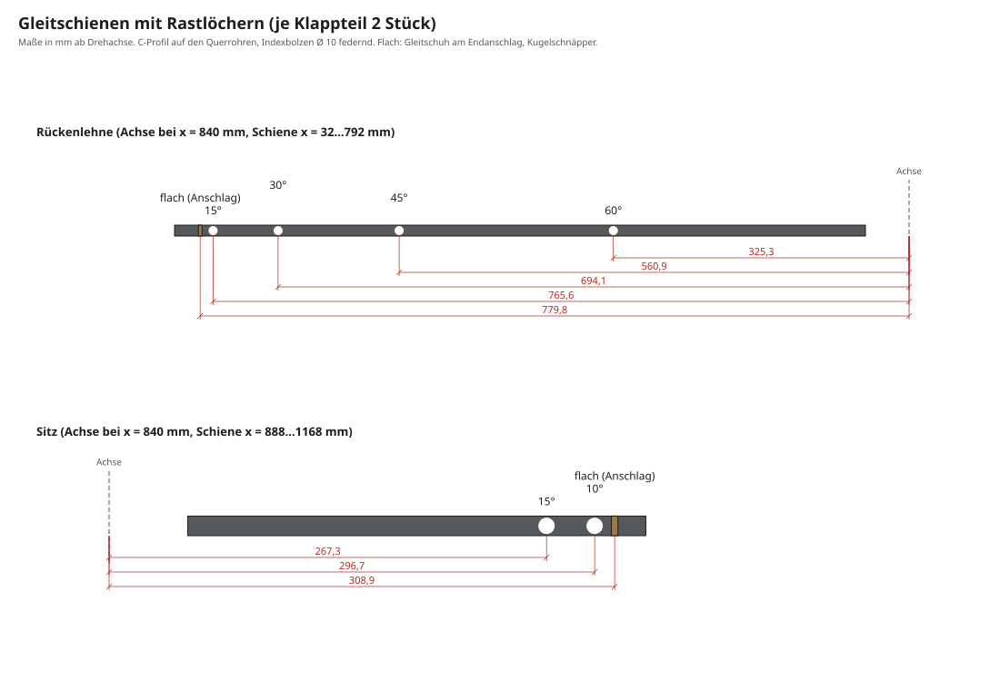
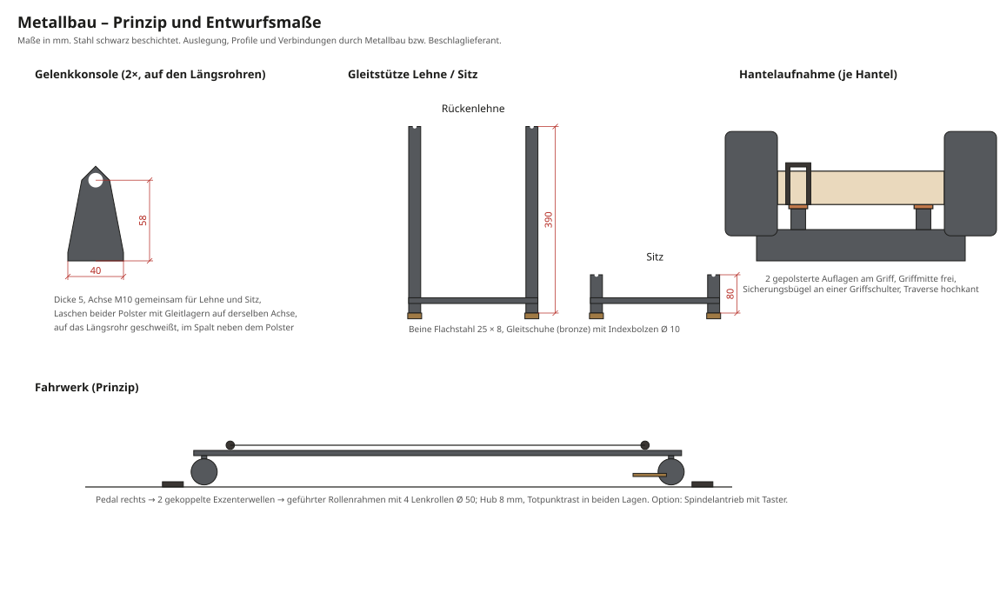
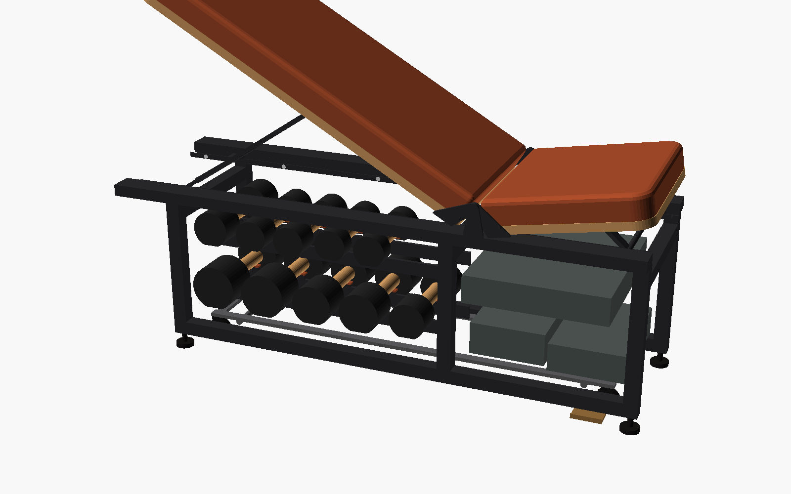
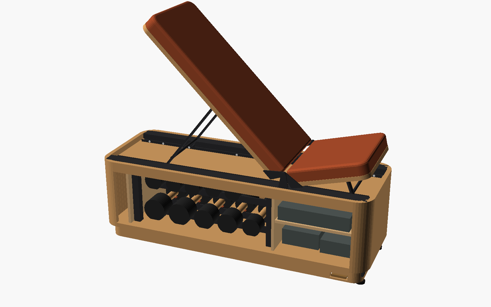

# Unterlagen für den Schreiner

Wohnbank für das Bettende mit Trainingsfunktion: Sitzbank, Flach- und Schrägbank mit Stauraum für Kurzhanteln.
Grundlage ist der **[Studio-Vorentwurf V01](vorentwurf-studio.pdf)**. Diese Unterlagen setzen ihn in Maße um und rechnen Mechanik, Stauraum, Durchbiegung und Kippsicherheit nach.
Sie sind ein **Planungsstand für Angebot und Abstimmung, keine Fertigungsfreigabe**. Die Zuschnittliste entsteht erst nach der Beschlagplanung.

**Maßgeblich sind die Zeichnungen und die [Stückliste](stueckliste.md).** Beide werden aus einer zentralen Parameterdatei erzeugt und passen zueinander.

## Das Wichtigste in Kürze

| Thema | Festlegung |
|---|---|
| Aufstellort | Bettende eines 180-cm-Betts. Rollfront zum Raum, Rückseite zum Bett (ist sichtbar) |
| Außenmaße | 1200 × 430 × 450 mm (L × T × H): Sockel 70 + Korpus 310 + Polsterpaket 70 |
| Form | Senkrechte Ecken im Grundriss R 70. Oben ein 25 mm hoher Rand, darin liegen die Polster wie in einer Wanne |
| Tragstruktur | Innenliegender Stahlrahmen trägt Polster, Hanteln und Füße. Die Holzverkleidung trägt nicht mit |
| Verkleidung | Formstabile Plattenkonstruktion 19 mm mit Eichenfurnier, Rundungen formverleimt, Frontleisten und Kanten Eiche massiv. Eiche natur, matt |
| Front | Rollfront aus senkrechten Eichenlamellen. Offen läuft sie links um die Ecke und hinten im Rücklaufkanal zurück |
| Innen | Tasche 100 mm, Hantelbereich 660 mm in 2 Ebenen, Zubehör 378 mm mit Fachboden. 369 mm Nutzraum tief |
| Polster | Rückenlehne 810 mm links, Sitz 330 mm rechts, Fuge 16 mm, 368 mm breit. Cognac-Leder auf Polsterplatten mit sichtbarer Eichenkante, austauschbar |
| Verstellung | Lehne 0/15/30/45/60°, Sitz 0/10/15°. Gemeinsame Drehachse, Gleitstützen mit federnden Indexbolzen, formschlüssig verriegelt |
| Hanteln | 10 Stück (5 Paar 2,5–10 kg) einzeln in gepolsterten Aufnahmen mit Sicherungsbügel auf Stahltraversen |
| Fahrwerk | Rollenrahmen mit 4 Lenkrollen, versenktes Bronze-Pedal vorn rechts, 8 mm Fußfreiheit. Option: Spindelantrieb mit Taster |
| Belastung | Nutzer bis 120 kg, gerechnet mit Stoßfaktor 1,5 ([Berechnung](berechnung.md)) |
| Gewicht | ca. 71 kg leer, ca. 135 kg mit Hanteln und Zubehör |

### Abweichungen vom Vorentwurf

| Vorentwurf | Hier | Grund |
|---|---|---|
| Höhe 460, Korpus 320 | **450**, Korpus 310 | Obergrenze der Wettkampfnorm für Flachbänke, Wunsch des Bauherrn |
| Polsterbreite 390 | **368** | Je Seite 12 mm Spalt für Gelenkkonsolen und Laschen. Bei der Liegeprobe bestätigen |
| Polster 820 + 10 + 330 | 810 + **16** + 330 | Die gemeinsame Drehachse liegt in der Fuge. Die Polsterkanten halten so in jeder Stellung mindestens 5 mm Abstand |
| Drehpunkt unten am Polster (Skizze) | Achse **oben**, 12 mm unter der Oberfläche | Mit der Achse unten würden die Kanten bei 60° rund 61 mm in die Fuge wandern |
| – | Flach: Endanschlag + Kugelschnäpper | Ein eigenes Rastloch für flach läge nur gut 10 mm neben dem 15°-Loch |

Alles andere ist übernommen. Die vollständige Gegenüberstellung steht im [Konzept](konzept.md).

## Wer macht was

Angebot bitte **getrennt nach diesen vier Gewerken**, wie im Vorentwurf:

| Gewerk | Umfang |
|---|---|
| **Holzbau** | Verkleidung mit Eckrundungen, Rollfront mit Laufnuten, Trennwände, Fachboden, Sockelzarge, Polsterplatten mit Eichenkante und Rippen, Oberfläche, Endmontage |
| **Polster** | Schaum, Watte, Leder mit Kedernaht auf die Polsterplatten. Das Leder endet oben auf der Platte, die Eichenkante bleibt sichtbar. Bezug austauschbar |
| **Metallbau und Beschläge** | Innenrahmen, Gelenkkonsolen und Laschen mit gemeinsamer Achse, 2 Gleitstützen, 4 Gleitschienen mit Rastlöchern, Indexbolzen, 10 Hantelaufnahmen, Stellfüße. Nachweis von Lasten, Verbindungen, Verriegelung und Kippsicherheit |
| **Fahrwerk** | Rollenrahmen, 2 gekoppelte Exzenterwellen, 4 Lenkrollen, Bronze-Pedal. Optional Spindelantrieb mit Taster |
| **Bauherr** | Hanteln ([hanteln.md](hanteln.md)) |

Ideal wäre es, wenn der Schreiner die Gewerke koordiniert. Der Rahmen entsteht zuerst, die Verkleidung wird an ihm aufgemessen.

## Kritische Maße

| Maß | Wert | Warum |
|---|---|---|
| Polsteroberkante | 450 mm | Sitzhöhe und Hantelbank-Norm |
| Drehachse | 840 mm ab linker Stirnseite, 438 mm über Boden (12 mm unter der Polsteroberkante) | Die Mechanik und der Fugenabstand sind darauf berechnet |
| Rastlöcher der Gleitschienen | nach [Zeichnung](zeichnungen/gleitschienen.svg), ±0,5 mm, jeweils beide Schienen gemeinsam bohren | Sonst stimmen die Winkel nicht, oder ein Bolzen rastet nicht ein |
| Wannentiefe (Rand über Wannenboden) | 25 mm | Darin liegen Längsrohre, Gleitschienen, Stützen und Rippen |
| Spalt Polster ↔ Rand | 12 mm vorn und hinten, 3 mm an den Stirnseiten | Darin sitzen Gelenkkonsolen und Laschen |
| Fuge Lehne ↔ Sitz | 16 mm | Achse in der Fugenmitte |
| Rahmenstützen | x = 133 / 759 / 1148 mm, y = 47 / 353 mm (30 × 30) | Durchbrüche in Boden und Wannenboden, Ausklinkungen im Fachboden |
| Laufnut Rollfront | 8 × 8 mm, kleinster Radius 50 mm | Die Lamellen laufen links um die Ecke. Endgültig nach dem gewählten Rolladensystem |
| Hantelbereich | untere Ebene 128 mm licht, Nutzraum 369 mm tief | Die größte Hantel ist 100 mm im Durchmesser und 286 mm lang |

## Zeichnungen

### Übersicht

### Querschnitt

### Gleitschienen: kritisches Maß

### Metallteile (Entwurf für den Metallbau)

### Tragwerk und Verstellbereich

### Training, Stauraum und Explosionsansicht

## Konstruktionsvorgaben

1. **Tragprinzip.** Der Stahlrahmen steht auf eigenen Stellfüßen und nimmt alle Trainingslasten auf: Polster über Gelenk und Gleitschienen, Hanteln über die Traversen.
   Die Verkleidung wird am Rahmen befestigt, lösbar verschraubt und trägt nicht mit. Keine tragenden Haken oder Beschläge in dünnen Holzteilen.
2. **Verkleidung.** Eichefurnierte Platten 19 mm (Tischlerplatte oder Multiplex nach Wahl des Schreiners). Vier Eckrundungen außen R 70 formverleimt, Furnier stehend, die Maserung läuft um die Ecke.
   Die Rückwand ist Sichtseite zum Bett und bekommt eine Wartungsöffnung für Fahrwerk und Pedal.
3. **Wannenboden.** Liegt 25 mm unter dem Rand, zwischen den oberen Querrohren und den Längsrohren des Rahmens. Durchbrüche für die 6 Stützen.
   Die Frontleiste oben (Eiche massiv, 44 mm hoch) bildet vorn den Rand und trägt die obere Laufnut.
4. **Rollfront.** Senkrechte Eichenlamellen ca. 18 × 14 mm mit gerundeter Vorderseite auf flexiblem Träger, oben und unten in Nuten geführt.
   Vorn gerade, links mit mindestens R 50 um die Ecke in die Tasche, dann im Rücklaufkanal hinter dem Nutzraum zurück. Die erste Lamelle rechts ist die Griffleiste.
   Kurvenradius, Lamellenmaß und Nut richten sich nach dem gewählten Rolladensystem. Vor der Fertigung eine Schablone testen.
5. **Innenraum.** Trennwände 12 mm, nicht tragend, enden vor dem Rücklaufkanal. Fachboden im Zubehörbereich auf Bodenträgern, mit Ausklinkungen für die Rahmenstützen.
   Die Hantelaufnahmen sitzen auf den Stahltraversen, nicht am Holz.
6. **Polsterplatten.** Multiplex 18 mm mit umlaufender Eichenkante. Außen sind die Ecken konzentrisch zur Korpusecke gerundet (R 39).
   Unter der Lehnenplatte zwei Eichenrippen 60 × 18 mm. Unterseiten furniert, weil man sie bei angestellten Polstern sieht.
   Gelenklaschen und Stützenlager werden mit Gewindehülsen angeschraubt, damit Polster und Bezug austauschbar bleiben.
7. **Mechanik (Metallbau).** Gemeinsame Achse M10 mit Gleitlagern auf zwei Gelenkkonsolen. Je Polster eine Gleitstütze aus 2 Flachstahlbeinen mit Quersteg, deren Gleitschuhe in C-Schienen laufen.
   Federnde Indexbolzen Ø 10, je Stütze gemeinsam mit einem Zugknopf zu lösen. Flachstellung über Endanschlag und Kugelschnäpper.
8. **Sockel.** Eichenzarge 20 mm, umlaufend mit gerundeten Ecken (R 45), 25 mm zurückgesetzt, Ausschnitt für das Pedal vorn rechts.
   Die Stellfüße sitzen unter den Eckstützen des Rahmens hinter der Zarge, höhenverstellbar mit Filz.
9. **Oberfläche.** Hartwachsöl matt. Den Farbton vorher am Musterbrett abstimmen. Stahl schwarz beschichtet.

## Vor der Fertigung klären

Aus dem Vorentwurf übernommen und ergänzt:

1. **Lasten:** Nutzergröße, maximales Nutzergewicht (gerechnet: 120 kg) und Trainingsgewichte (Hanteln bis 10 kg je Hand) bestätigen.
2. **Hanteln:** fertige Hanteln vermessen, Anzahl und Aufnahmen mit einem Papp- oder Holzmodell im Innenraum prüfen.
3. **Sitz- und Liegeprobe:** Länge, Polsterbreite 368 mm, Festigkeit und Verstellwinkel bestätigen.
4. **Rollfront:** Rolladensystem auswählen, Rücklauf, Nutzraum und Wartungszugang gemeinsam planen.
5. **Nachweis:** Metallbau bzw. Beschlaglieferant weist Lasten, Verbindungen, Verriegelung und Kippsicherheit nach.
6. **Fahrwerk:** mit voller Beladung (ca. 135 kg) testen: Bodenfreiheit, Pedalkraft, kontrolliertes Absenken.
7. **Fingerfreiheit am Gelenk:** Die Fuge ist flach 16 mm breit und wird beim Anstellen bis auf gut 5 mm schmaler. Klemmstellen an Polsterplatten und Laschen prüfen, bei Bedarf abdecken.
8. **Gelenk-Oberfläche:** Das Gelenk ist im Spalt zwischen den Polstern sichtbar. Schwarz wie die Hanteln oder bronziert wie das Pedal.

## Vorschlag für den Ablauf

1. Erstgespräch mit diesen Unterlagen und dem Vorentwurf, danach Angebot nach Gewerken.
2. Muster: Eiche mit Öl, Lederprobe, Rolladensystem (Lamellen um R 50).
3. Liegeprobe mit einem einfachen Probeaufbau, Pappmodell der Hantelaufnahmen.
4. Metallbau: Rahmen mit Gelenk, Gleitstützen und Fahrwerk fertigen, Nachweis führen.
5. Rahmen und Mechanik ohne Verkleidung probemontieren: alle Rasten, Verriegelung und Fahrwerk beladen prüfen.
6. Verkleidung, Rollfront und Polsterplatten nach Aufmaß am Rahmen.
7. Polster, danach Endmontage.
8. Abnahme:
    - Lehne und Sitz in jeder Stellung mit ca. 100 kg belasten, Bolzen rasten eindeutig ein.
    - Rollfront läuft leicht über den ganzen Weg.
    - Fahrwerk hebt und senkt sauber, Transportstellung verriegelt.
    - Die Bank steht kippelfrei.

## Fragen an den Schreiner

- Welche Plattenkonstruktion und welches Furnier für die Verkleidung? Rundungen formverleimt oder anders?
- Welches Rolladensystem für eine Front, die um die Ecke läuft?
- Übernimmt die Schreinerei die Koordination aller vier Gewerke?
- Gibt es einen Metallbauer oder Beschlaglieferanten, mit dem Sie zusammenarbeiten? Lässt sich das Fahrwerk mit fertigen Hubrollen-Beschlägen vereinfachen?
- Wo sitzt die Wartungsöffnung am besten?

## Anfrage zum Kopieren

> Guten Tag,
>
> ich plane eine Wohnbank mit Trainingsfunktion für das Ende meines Betts: im Alltag eine Sitzbank, zum Training eine verstellbare Flach- und Schrägbank mit Stauraum für Kurzhanteln.
> Außenmaße 1200 × 430 × 450 mm, Eiche furniert mit gerundeten Ecken, Rollfront aus Eichenlamellen, Cognac-Lederpolster, innenliegender Stahlrahmen mit verriegelnden Beschlägen und ein verdecktes Fahrwerk mit Fußpedal.
> Einen Vorentwurf, Zeichnungen, Stückliste und eine Beschreibung der Konstruktion habe ich angehängt.
>
> Könnten Sie mir ein Angebot machen, getrennt nach Holzbau, Polster, Metallbau/Beschlägen und Fahrwerk? Gern auch mit Ihren Vorschlägen zu Rollfront und Koordination der Gewerke.
>
> Vielen Dank und viele Grüße
